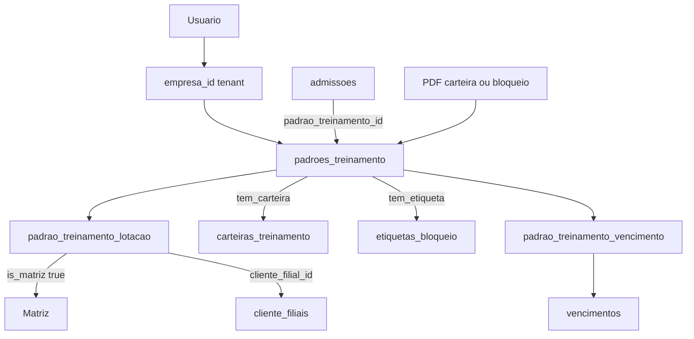

# Padrão de Treinamento — Spec (v1)

Documento de produto e técnico. **Fonte da verdade antes da implementação.**  
Não descreve código ainda inexistente; define o que deve ser construído e como migrar o legado (`SegmentoTreinamento`).

Documentos relacionados:

- [TREINAMENTOS_CARTEIRA_ETIQUETAS_REFATORACAO.md](TREINAMENTOS_CARTEIRA_ETIQUETAS_REFATORACAO.md) — tela operacional Carteira/Etiquetas
- [TREINAMENTOS_CARTEIRA_ETIQUETAS_AUDITORIA_E_HISTORICO.md](TREINAMENTOS_CARTEIRA_ETIQUETAS_AUDITORIA_E_HISTORICO.md) — auditoria na carteira
- Legado atual: model `SegmentoTreinamento`, tabela `segmentos_treinamento`, pivot `cliente_segmento_treinamento`

---

## 1. Objetivo e motivação

### Problema

Hoje o cadastro chamado **Segmento de treinamento** (ALUMAR, VALE, etc.) mistura:

1. Identidade do “padrão” usado na admissão e na carteira
2. Template visual de **carteira** e **etiqueta de bloqueio** (`config_carteira` JSON)
3. Filtro de **vencimentos** (`vencimentos.segmento_treinamento_id`)

O cadastro é global (só empresa 100). A empresa apenas habilita segmentos no cadastro de Cliente. Na prática, o cliente pede um **agrupamento de treinamentos** com nome de **padrão**, podendo ou não gerar carteira/etiqueta, e podendo valer para **Matriz e/ou Filiais**.

### Objetivo v1

Separar em três conceitos claros:

| Conceito | Função |
|----------|--------|
| **Carteira de treinamento** (modelo) | Layout do PDF da carteira (imagens) |
| **Etiqueta de bloqueio** (modelo) | Layout/textos do PDF de bloqueio |
| **Padrão de treinamento** | Agrupamento da empresa: nome + treinamentos + se usa carteira/etiqueta + **onde vale** (Matriz/Filiais) |

### Fora deste documento (pós-implementação)

- Atualização do Manual Completo (`docs/manual-completo/secoes/11-treinamento.html`)
- Nota em `.notebook/`

---

## 2. Glossário

| Termo | Significado |
|-------|-------------|
| **Tenant / `empresa_id`** | Empresa do usuário logado (`auth()->user()->empresa_id`). Isolamento multi-tenant. No padrão, **sempre** preenchido. |
| **Matriz** | Unidade CNPJ principal do cliente (não é linha em `cliente_filiais`). |
| **Filial** | Registro em `cliente_filiais` ligado ao mesmo `empresa_id` do tenant. |
| **Lotação** | Matriz **ou** uma Filial — “de onde é” o padrão / o colaborador. |
| **Carteira (modelo)** | Template visual do PDF carteira (`cabecalho_img`, `verso_img`, …). |
| **Etiqueta de bloqueio (modelo)** | Template do PDF de bloqueio (textos, ramal, …). |
| **Padrão de treinamento** | Agrupamento criado pela empresa: treinamentos + flags de documentos + lotações. |
| **Vencimento** | Cadastro de “treinamento da indústria” (`vencimentos`) que entra no agrupamento via pivot. |
| **Status carteira na admissão** | `status_carteira_treinamento` / fluxo de entrega — **não** é o modelo de carteira; permanece como está. |
| **Segmento (legado)** | `segmentos_treinamento` — será migrado e deprecado. |

**Atenção:** na UI o usuário pode falar “empresas” para Matriz + Filiais. No banco isso **não** é outro `empresa_id` de tenant; é a pivot de **lotação**.

---

## 3. Papéis e permissões

| Papel | Pode criar / editar | Escopo |
|-------|---------------------|--------|
| Admin MyBP (**empresa 100**) | Modelos de **Carteira** e **Etiqueta** | Globais (`empresa_id` null) e, se necessário, visão admin |
| Qualquer empresa (tenant) | Modelos de **Carteira** e **Etiqueta** **customizados** | `empresa_id` = tenant |
| Qualquer empresa (tenant) | **Padrão de treinamento** | `empresa_id` = tenant + pivot de lotação |
| Empresa tenant | Consumir modelos **globais** no combo | Somente leitura no modelo global |

Regras:

- Tenant **não** edita nem apaga modelo global.
- Tenant **nunca** vê/edita carteira, etiqueta ou padrão de outro `empresa_id`.
- Gate de CRUD global: mesmo critério atual de segmentos (`empresa_id === 100`).

---

## 4. Modelo de domínio



---

## 5. Modelo de dados

### 5.1 `carteiras_treinamento`

| Coluna | Tipo | Regra |
|--------|------|--------|
| `id` | PK | |
| `empresa_id` | FK nullable → `clientes` / empresas | `null` = global; preenchido = custom do tenant |
| `nome` | string | |
| `slug` | string | Unique por escopo (ver índices) |
| `ativo` | bool | default true |
| `cabecalho_img` | string | caminho relativo imagem |
| `verso_img` | string | caminho relativo imagem |
| `created_at` / `updated_at` | timestamps | |

### 5.2 `etiquetas_bloqueio`

| Coluna | Tipo | Regra |
|--------|------|--------|
| `id` | PK | |
| `empresa_id` | FK nullable | `null` = global; preenchido = custom |
| `nome` | string | |
| `slug` | string | Unique por escopo |
| `ativo` | bool | |
| `ramal_emergencia` | string | |
| `bloqueio_texto_nao_use` | string | |
| `bloqueio_texto_demissao` | string | |
| `bloqueio_texto_cuidado` | string | |
| `bloqueio_texto_homens_trabalhando` | string | |
| timestamps | | |

Listagem para o tenant: `WHERE empresa_id IS NULL OR empresa_id = :tenant`.

### 5.3 `padroes_treinamento`

| Coluna | Tipo | Regra |
|--------|------|--------|
| `id` | PK | |
| `empresa_id` | FK **obrigatório** | Tenant do usuário |
| `nome` | string | |
| `slug` | string | Unique por `(empresa_id, slug)` |
| `ativo` | bool | |
| `tem_carteira` | bool | |
| `carteira_treinamento_id` | FK nullable | Obrigatória se `tem_carteira`; deve ser global ou da mesma empresa |
| `tem_etiqueta_bloqueio` | bool | |
| `etiqueta_bloqueio_id` | FK nullable | Obrigatória se `tem_etiqueta_bloqueio`; mesma regra de escopo |
| timestamps | | |

Índice sugerido: `(empresa_id, ativo)`.

### 5.4 `padrao_treinamento_lotacao` (pivot “Válido para”)

“De onde é aquele padrão” — Matriz e/ou Filiais do **mesmo** tenant.

| Coluna | Tipo | Regra |
|--------|------|--------|
| `padrao_treinamento_id` | FK | |
| `is_matriz` | bool | `true` = linha Matriz |
| `cliente_filial_id` | FK nullable → `cliente_filiais` | `null` se Matriz; obrigatório se Filial |
| PK / unique | | Ver MySQL 5.7 abaixo |

Validações de aplicação:

- Filial deve ter `cliente_filiais.empresa_id = padroes_treinamento.empresa_id`.
- No máximo **uma** linha Matriz por padrão (`is_matriz = 1`).
- Não duplicar a mesma filial no mesmo padrão.
- Ao salvar o padrão (UI nova): exigir **pelo menos uma** lotação.

**MySQL 5.7:** unique com `NULL` em `cliente_filial_id` é frágil. Usar:

- Coluna `is_matriz` explícita
- Unique `(padrao_treinamento_id, cliente_filial_id)` apenas para filiais (quando não null)
- Unique / regra em app para “só uma matriz”: índice gerado ou validação no service (`where is_matriz = 1`)

Semântica:

| Situação | Pivot |
|----------|--------|
| Cliente sem filiais | Só Matriz disponível na UI |
| Cliente com 1..N filiais | Usuário adiciona Matriz e/ou Filiais desejadas |
| Migração legado | Inserir 1 linha Matriz por padrão gerado |

### 5.5 `padrao_treinamento_vencimento`

| Coluna | Tipo |
|--------|------|
| `padrao_treinamento_id` | FK |
| `vencimento_id` | FK |
| PK composta | `(padrao_treinamento_id, vencimento_id)` |

Um vencimento pode participar de vários padrões da mesma empresa. Validar `vencimentos.empresa_id = padrão.empresa_id`.

### 5.6 Admissão e assinaturas

- `admissoes.padrao_treinamento_id` (FK nullable na migração; backfill a partir de `segmento_treinamento_id`)
- `carteira_assinaturas`: amarrar a `padrao_treinamento_id` (null = fallback da empresa), no mesmo espírito do vínculo atual com segmento

Colunas legadas (`segmento_treinamento_id`, tabelas de segmento) permanecem por um ciclo com dual-read; remoção em migration futura.

---

## 6. Regras de negócio

### 6.1 Carteira e etiqueta no padrão

- `tem_carteira = false` → não exige FK; PDF tipo carteira **não** é gerado para esse padrão.
- `tem_etiqueta_bloqueio = false` → idem para PDF de bloqueio.
- Se flag true, FK obrigatória e modelo deve estar `ativo` e no escopo (global ou mesma empresa).

### 6.2 Combos de template

Na criação/edição do padrão, listas de carteira e etiqueta:

```
globais ativas UNION customizadas ativas do tenant
```

Ordenar por nome; opcionalmente agrupar visualmente “Global” vs “Da empresa”.

### 6.3 Resolução na admissão / carteira operacional

Select de padrões disponíveis:

1. `padroes_treinamento.empresa_id = tenant`
2. `ativo = true`
3. Filtrar pela **lotação da admissão** (centro de custo → Matriz ou `cliente_filial_id`):
   - Matriz → padrões com linha `is_matriz = true`
   - Filial X → padrões com `cliente_filial_id = X`

Se o select ficar vazio: mensagem clara (“nenhum padrão válido para esta lotação”).

### 6.4 PDF (`carteiraPdf` e equivalentes)

1. Resolver padrão da admissão (`padrao_treinamento_id`).
2. Se tipo carteira e `tem_carteira`: carregar modelo de carteira.
3. Se tipo bloqueio e `tem_etiqueta_bloqueio`: carregar modelo de etiqueta.
4. Vencimentos do PDF: apenas os do pivot `padrao_treinamento_vencimento` (não mais `segmento_id OR null`).
5. Assinaturas: específicas do padrão → fallback da empresa (`padrao_treinamento_id` null).

Flags de `ClienteConfig` (ex.: `supervisor_etiqueta_bloqueio`) **permanecem** — não fazem parte do modelo de padrão.

### 6.5 Isolamento

Toda query de escrita/leitura de padrão, lotação, vínculo de vencimento e uso de template custom **deve** filtrar pelo `empresa_id` do usuário. Templates globais são a única exceção de leitura cruzada (sem `empresa_id` de outro tenant).

---

## 7. Interfaces (UI)

### 7.1 Admin (empresa 100) — Carteiras e Etiquetas globais

- Menu único **Cadastro → Carteiras e Etiquetas** (`carteirastreinamento`), com abas **Carteiras** | **Etiquetas de Bloqueio**.
- Query `?aba=etiquetas` abre a aba de etiquetas; a rota antiga `etiquetasbloqueio` redireciona para essa aba.
- Formulários com os campos das seções 5.1 e 5.2 (`empresa_id` null).

### 7.2 Empresa — Carteiras e Etiquetas customizadas

- Mesma tela com abas, gravando `empresa_id = tenant`.
- Listagem: só as próprias (globais aparecem apenas no combo do padrão, não como editáveis).

### 7.3 Empresa — Padrão de treinamento (cadastro novo)

Campos:

- Nome, slug (ou slug gerado), ativo
- Switch **Usa carteira** + combo de carteira (se ligado)
- Switch **Usa etiqueta de bloqueio** + combo de etiqueta (se ligado)
- **Tabela “Válido para”** (pivot lotação):
  - Fonte: lista Matriz + filiais ativas do tenant (mesmo padrão de CNPJ da carteira/CC: `matriz ? id : filial_id`)
  - Fluxo: escolher lotação → **Adicionar** → linha na tabela (tipo, nome/CNPJ, remover)
  - Sem filiais cadastradas: só Matriz no combo
  - Com 1+ filiais: Matriz e Filiais selecionáveis
- Multi-select / tabela de **treinamentos (vencimentos)** da empresa

Padrão visual: cadastro MyBP (listagem cards + modal `mybp-modal-form` / filtros conforme docs UX do projeto).

### 7.4 Consumidores (labels já usam “Padrão de treinamento” em vários pontos)

- Admissão (individual e massa)
- Treinamentos Carteira/Etiquetas
- Treinamento Indústria (vínculo deixa de ser “segmento global” e passa pelo N:N do padrão)
- Assinatura da carteira

### 7.5 Cadastro de Cliente

- Remover checkboxes `segmentos_treinamento_ids` / pivot `cliente_segmento_treinamento` da UI (após migração).

---

## 8. Migração a partir de `segmentos_treinamento`

Ordem sugerida (transacional / script idempotente):

1. Para cada segmento ativo: criar 1 **carteira global** + 1 **etiqueta global** a partir de `config_carteira` (nome/slug do segmento; `exibir_etiqueta_bloqueio` vira dado da etiqueta / flag no padrão).
2. Para cada tenant que usava o segmento (pivot `cliente_segmento_treinamento` e/ou admissões/vencimentos com aquele `segmento_treinamento_id`): criar `padroes_treinamento` com o mesmo nome, flags conforme config antiga, FKs para os modelos globais gerados.
3. Em cada padrão migrado: inserir **1 linha Matriz** em `padrao_treinamento_lotacao`.
4. Vencimentos com `segmento_treinamento_id = X`: vincular no pivot do padrão correspondente da **mesma** `empresa_id` do vencimento.
5. Backfill `admissoes.padrao_treinamento_id` pelo par (empresa da admissão + segmento antigo).
6. Remapear `carteira_assinaturas.segmento_treinamento_id` → `padrao_treinamento_id` quando houver padrão equivalente no tenant.
7. Dual-read: se `padrao_treinamento_id` null, fallback temporário via segmento / ALUMAR até estabilizar.
8. Migration futura: dropar colunas/tabelas de segmento e pivot `cliente_segmento_treinamento`.

Vencimentos com `segmento_treinamento_id` null (genéricos): na migração, vincular explicitamente aos padrões da empresa que devem continuar vendo esses treinamentos (definir regra no script: todos os padrões do tenant ou só o padrão default migrado do ALUMAR).

---

## 9. Impacto por área

| Área | Mudança |
|------|---------|
| Admissão | Select de padrões do tenant filtrados por lotação; persistir `padrao_treinamento_id` |
| Carteira / Etiquetas (PDF e tela) | Layout e vencimentos a partir do padrão |
| Assinaturas carteira | FK padrão em vez de segmento |
| Treinamento Indústria | Vínculo via padrões (N:N), não segmento global |
| Relatórios / schedule vencimento | Nome/filtro por padrão da admissão |
| Importação treinamentos | Normalizar padrão em vez de (ou além de) segmento |
| Cliente admin | Remove habilitação de segmentos |
| API externa admissão | Expor `padrao_treinamento_id` (e deprecar segmento com aviso) |

Arquivos de referência do legado (para o implementador):

- `app/Models/SegmentoTreinamento.php`
- `app/Http/Controllers/SegmentoTreinamentoController.php`
- `app/Http/Controllers/TreinamentoController.php` (`carteiraPdf`, resolução de segmento/assinatura)
- `resources/js/components/cadastros/segmentostreinamento/SegmentosTreinamentoCadastro.vue`
- `resources/js/components/treinamentos-carteira-etiquetas/TreinamentosCarteiraEtiquetas.vue`
- `resources/js/g/administracao/clientes/app.js` (`segmentos_treinamento_ids`)

---

## 10. Fora do escopo v1

- Override de layout de carteira/etiqueta **sem** passar pelo padrão
- Padrão ou template escopado só por centro de custo (além de Matriz/Filial)
- Alterar semântica de `status_carteira_treinamento` / entrega na admissão
- Empresa tenant editando templates globais

---

## 11. Riscos e mitigações

| Risco | Mitigação |
|-------|-----------|
| Confundir tenant `empresa_id` com “empresas” Matriz/Filial | Naming `lotacao` na pivot e UI “Válido para (Matriz/Filial)” |
| Unique Matriz no MySQL 5.7 | `is_matriz` + validação no service |
| Select de padrão vazio por lotação | Incluir só padrões da lotação; UX com mensagem; migração sempre com Matriz |
| Vazamento multi-tenant | Validar FK de carteira/etiqueta/filial/vencimento no mesmo tenant (ou global) |
| PDF quebra pós-migração | Seed/backfill ALUMAR global + fallback dual-read |
| Vencimentos genéricos somem do PDF | Regra explícita no script de migração (seção 8) |

---

## 12. Checklist de implementação

Usar nesta ordem. **Não iniciar item 2 sem o item 1 concluído e revisado.**

- [x] **1. Documentação** — este arquivo (`docs/PADRAO_TREINAMENTO.md`)
- [x] **2. Schema** — migrations das tabelas/pivots + FKs na admissão/assinaturas + script de backfill
- [x] **3. Models / services** — Eloquent, validação de escopo, sync de lotações e vencimentos
- [x] **4. CRUD Carteira e Etiqueta** — global (100) + custom (tenant)
- [x] **5. CRUD Padrão** — formulário + tabela “Válido para” + vínculo vencimentos
- [x] **6. Consumidores** — admissão, carteira PDF, filtros, assinaturas, indústria (`atualizar` lista por pivot do padrão; remigração `mybp:migrar-padroes-treinamento`)
- [ ] **7. Cleanup Cliente** — remover UI/pivot de segmentos habilitados
- [x] **8. Testes** (SQLite `:memory:`): migração Segmento→Padrão + filtro Matriz/Filial (`PadraoTreinamentoMigracaoTest`)
- [ ] **9. Notebook + Manual do usuário** — após feature estável

---

## 13. Decisões fechadas (v1)

1. Documentação antes de código.
2. Carteira/Etiqueta: global **ou** por empresa.
3. Padrão: sempre com `empresa_id` do tenant.
4. Lotação: pivot com Matriz e/ou Filiais, adicionáveis na tela.
5. Filial não é obrigatória no cliente; banco e UI cobrem 0, 1 ou N filiais.
6. Treinamentos do padrão via N:N com vencimentos.
7. Habilitação de segmento no Cliente deixa de existir após migração.
